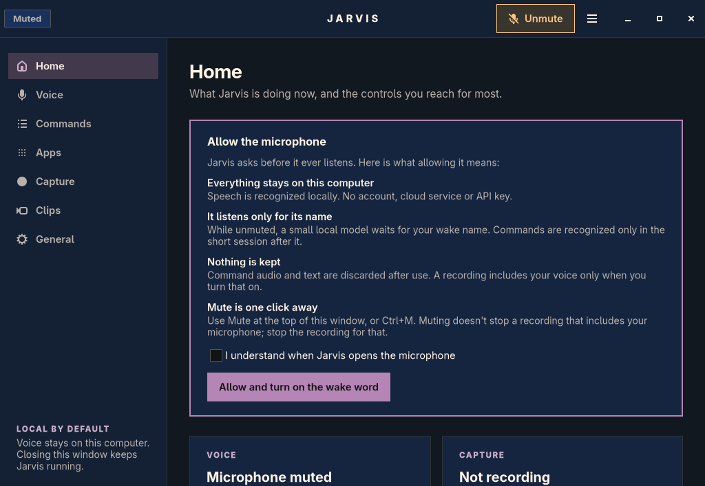
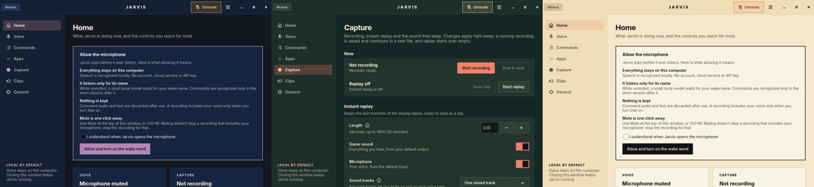

# Settings window

Jarvis uses Python and GTK4 through PyGObject on Linux, and Tk/ttk on Windows. There is no browser runtime in the product. The window is a separate process from the service: closing it releases its widgets while voice control and recording continue. Opening settings never starts the service or opens a microphone; **Start Jarvis** is an explicit action.



## Layout

A sidebar with icons holds seven pages. The desktop entry opens **Home**; its **Open recorder** action opens **Capture** without starting capture. On every page the header shows the voice state (Connecting, Muted, Waiting for wake word, Listening, Working, Dictating, Needs attention, Offline), a **Replay on** pill while instant replay keeps its buffer, **Mute** / **Unmute** with a microphone icon, and a ☰ menu with Export settings…, Import settings…, Open backups folder and **Quit Jarvis…** (which asks first, since it stops voice control and replay).

- **Home:** on first run, what allowing the microphone means and the consent to do it; then the voice state with **Listen now** and **Start dictation** (with any text that couldn't be typed and a Copy button) and an **Arabic** switch; recording and replay state with the sound each keeps, **Save clip**, **Start recording** and **Clips**; a few phrases to try. When the service is off, **Start Jarvis** and **Try again**.
- **Voice:** wake word and names; language and the Arabic model; dictation (start/stop, language, stop phrases, quiet timeout, typing into any app, the Hyprland shortcut); microphone input, level and test; recognition, with **Fine-tuning** folded away.
- **Commands:** the short “Say this” list, every command (searchable, 30 at a time), and your own shortcuts.
- **Apps:** installed apps with what to say and **Add voice name** on each row (duplicates such as Flatpak copies shown once), your voice names and their launch words, close words, and adding programs without a launcher entry.
- **Capture:** **Now** (recording and replay state and controls), Instant replay, Source and files, Picture and size (presets, with the exact format, resolution, frame rate and bitrate folded away and formats tested on the display's GPU), and **Advanced**.
- **Clips:** a compact library and the clip editor ([clips](clips.md)).
- **General:** colors, privacy, start at login, your settings file, keyboard shortcuts and Quit.

Each setting is one row: a name, one line saying what it does, and the control. Where more is worth knowing (HDR, separate tracks, password fields), an ⓘ button opens the details, so the page stays short. Content is centered at a readable width in a wide window; button rows wrap and long choices end in “…” on a narrow one (the window is at least 800 × 540).

The Windows window keeps the same apply-as-you-change saving, but is laid out differently, so that what you use most is in front of you. Its sidebar holds six pages, with status, **Mute** and the menu always in the same corner:

- **Home** fits on one screen: the voice state with the one action that fits it, a tile each for recording, instant replay and dictation whose buttons follow their state, quick settings, and phrases to try.
- **Voice** has tabs for the wake word and microphone, language, dictation, and fine-tuning.
- **Apps & commands** has tabs for apps, which load when first opened, what you can say, and your shortcuts.
- **Capture** has tabs for recording, instant replay, and picture and size. A preset is enough; the format, bitrate and encoder are folded under **Show all options**. The replay tab says whether the budget holds the chosen length at the current bitrate.
- **Clips** has tabs for the library, sound, and editing and export. Opening a clip moves to its sound.
- **Settings** has tabs for general settings, privacy and diagnostics.

It adds the neutral **Graphite** colors, and is its default for anyone who hasn't chosen colors. Its rounded controls are small opaque pictures drawn once by `windows/look.py`. Pictures are large enough that ttk needs few tiles to fill a card, because each tile is drawn separately. Text wraps only on a page that can be seen: a hidden page has no width of its own, and its text and size would otherwise chase each other forever.

## Settings apply as they change

There are no Save buttons. Switches and lists save just after a change, numbers once you pause, and text when you press Enter or leave the field; a burst of changes makes one save. Text typed and not yet confirmed is saved when the window closes. A short message at the bottom confirms each save and fades; an error (an invalid value, a format that failed the GPU test) stays until dismissed, and the change isn't saved. With the service off, the Linux window says so and keeps nothing; the Windows window writes the settings file directly, as before.

Every save fetches the service's current settings and merges the changed group, so unrelated settings survive, and saves are serialized. A save that changes what a running recording or replay captures restarts it, as the message says: the recording so far is saved as its own file, and replay starts over empty. Settings the service reads only when it needs them, **Recording sounds** and recorder setup completion, never restart a capture. Values the window fills in itself (loading settings, a newly found display, a preset adjusted to the GPU it was tested on) are shown, not saved, unless you changed the display.

## Colors

Three presets come from Sanzo Wada's *A Dictionary of Color Combinations* (1933), each one of the book's numbered combinations: **No. 344** Violet & cinnamon (dark, the default), **No. 166** Grenadine & slate green (dark) and **No. 190** Ivory & English red (light). Choose one in **General → Colors**; it applies at once and is kept in `appearance.json` beside `config.json`, for this window only.



`palettes.py` holds the pigments (from the MIT-licensed [dataset of the book](https://github.com/mattdesl/dictionary-of-colour-combinations)) and derives the roles a window needs (page, cards, lines, muted text, accent, live state) by mixing the combination's own colors with each other, with paper white or with the book's Black; errors use the book's Carmine Red and Corinthian Pink. `style.css` uses only those roles, and `ui.load_theme` prepends the chosen preset's colors. A test checks every preset against WCAG AA: at least 7:1 for body text, 4.5:1 for secondary text and text on buttons and pills, and 3:1 for the focus ring. Live colors (cinnamon, Naples yellow, English red) mark live states only: listening, working, recording and replay.

## Privacy and microphone lifecycle

The default activation mode is hands-free wake-word detection **after consent**. Before consent, the service keeps microphone input closed and Home explains what allowing it means; the consent box must be ticked before **Allow and turn on the wake word**. The service validates consent before opening audio even if another client asks.

**Mute** closes voice-control input. Microphone sound in a recording is a separate, deliberate capture setting; stop the recording to end that capture. The input-level test opens input only on request, updates the meter from service events, ends after 15 seconds, and is stopped when the window closes. Command audio and transcripts are not saved.

Screen recording requires choosing a display and starting a first recording from the window, which marks recorder setup complete. That cannot bypass compositor or portal permission prompts. Opening Capture never starts capture.

## Accessibility and interaction

All controls are native GTK widgets with accessible labels; icons are decorative and hidden from screen readers, and ⓘ buttons are named after their setting. Keyboard focus is always visible, text wraps, pages scroll, and relative font sizes follow desktop text scaling. Messages appear in a status region. The only animation is GTK's own short slide for messages, which follows the desktop's animation setting; there are no repeating timers or frame callbacks. Keyboard shortcuts while the window is open:

| Shortcut | Action |
| --- | --- |
| Ctrl+M | Mute or unmute voice input; first-use consent is still required |
| Ctrl+Space | Listen now; cancel an active command session |
| Ctrl+D | Start or stop dictation |
| Ctrl+K | Commands |
| Ctrl+W | Close the window |

Enabling **Start at login** calls `set_startup`; the optional user service must first be installed using the README procedure. The window never edits Hyprland configuration.

## Event and resource model

A blocking private Unix-socket subscription delivers status changes. GTK updates are marshalled onto the main thread with `GLib.idle_add`; IPC, device discovery and settings writes run in worker threads. There is no periodic status polling, no continuously redrawing meter, and no voice model imports. Saving uses one-shot timers only. The sole bounded startup retry waits at most 5 seconds for an explicitly launched service socket.

Application discovery and command references load when the window opens or reconnects. When the voice worker reports readiness, its pushed `unsupported_phrases` list updates each app's speech support and a short dictionary notice. Names outside the local English dictionary need a common-word voice name; for example, Stremio can use “stream video”. Loading states do not establish dictionary support, and repeated level events do not rebuild the app list. Microphones and displays refresh with the ↻ button beside Input.

## Verification

On 6 November 2026, with GTK 4.24.1 and PyGObject 3.58 on the GTK Broadway test display (never the desktop):

- every page built and rendered in all three presets, connected both to the live service (read only) and to an isolated service with its own temporary settings, socket and state, microphone consent off throughout;
- against the isolated service, a switch, a number (two quick changes, one save), text confirmed with Enter, close words, replay length, a picture preset and a dropdown each saved the expected setting; opening the window saved nothing; text typed and not confirmed was saved on close; the color choice was kept; a duplicate wake name was refused with the service's own message;
- every page's minimum width fits the 800-pixel window minimum with the live service's long app and audio-device names.

The Windows window was rendered page by page on a private Xvfb display in two presets, and its tests (pages and older `--page` names, saving with the service off, refusing invalid values, shortcuts as a list, recoloring) run on Linux under Xvfb and in the Windows CI job. It has not yet been opened on Windows itself.

Broadway is a test transport only, not a shipped dependency; it doesn't draw rounded corners, so the screenshots are square-cornered. GTK 4.24's `Gtk.Accessible.announce()` crashed the window without an accessibility bus, so messages use a status-role region instead. Real-session screen-reader behavior, fractional scaling and microphone/recording interactions still need checking in Hyprland.

For a construction check without audio, start a temporary `gtk4-broadwayd :18`, then run:

```sh
GDK_BACKEND=broadway BROADWAY_DISPLAY=:18 PYTHONPATH=src python - <<'PY'
from jarvis.ui import Gtk, JarvisWindow, load_theme
assert Gtk.init_check()
app = Gtk.Application(application_id="org.jarvis.ConstructionCheck")
app.register(None)
load_theme()
window = JarvisWindow(app)
assert window.stack.get_pages().get_n_items() == 7
window.close()
print("Seven native GTK pages constructed")
PY
```

Official API references used: [Gtk.Application](https://docs.gtk.org/gtk4/class.Application.html), [Gtk.DropDown](https://docs.gtk.org/gtk4/class.DropDown.html), [Gtk.AlertDialog](https://docs.gtk.org/gtk4/class.AlertDialog.html) and [GLib.idle_add](https://docs.gtk.org/glib/func.idle_add.html). Install GTK4 and PyGObject using your distribution packages. The window prints setup guidance when GTK or a graphical display is unavailable; the service and CLI remain separate.
